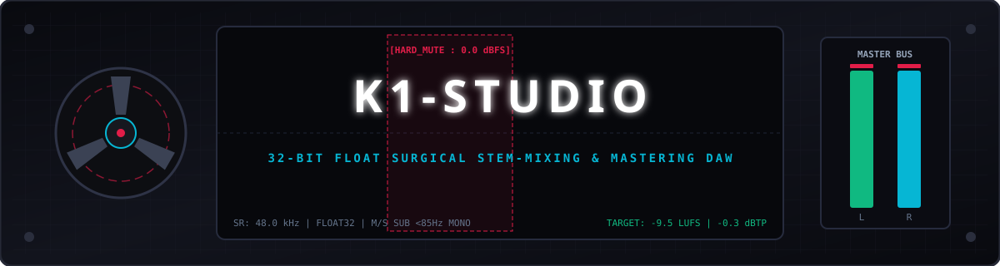

<div align="center">



<br/><br/>

<a href="https://github.com/reARbitRA/K1-STUDIO">
  
</a>

<br/>


</div>

---

## Overview

**K1-STUDIO** is a local-first, single-screen Digital Audio Workstation (DAW) and mastering console engineered for surgical post-production, stem mixing, non-destructive time-region FX automation, and analog-modeled mastering.

Unlike traditional bloated DAWs that require tedious sample-level slicing and manual crossfade drawing, **K1-STUDIO** uses a deterministic **Zero-Crossing Region DSP Engine**: select any time interval on the waveform, assign an effect preset, and the engine automatically locates the nearest zero-crossing within `±5 ms` and applies raised-cosine micro-crossfades for 100% click-free transitions.

---

## Signal Processing Architecture

```mermaid
flowchart LR
    subgraph INGEST["1. Ingest & Stem Engine"]
        A["WAV / FLAC / AIFF"] --> B["48kHz / Float32 Resampler"]
        B --> C["Optional Demucs v4\n2-Stem / 4-Stem Split"]
    end

    subgraph TRACK["2. Per-Track Channel Strip"]
        C --> D["Pre-Gain & Phase Ø"]
        D --> E["HPF + De-Mud (290Hz)\nPresence (2.65kHz) + De-Fizz"]
        E --> F["Channel Compressor"]
        F --> G["Zero-Crossing Region FX\n(Raised-Cosine Crossfade)"]
        G --> H["-3dB Equal-Power Pan"]
    end

    subgraph MASTER["3. Analog Master Bus"]
        H --> I["-6dBFS Summing Headroom"]
        I --> J["Mid/Side Matrix\nZero-Phase <85Hz Mono"]
        J --> K["Pultec EQP-1A Curve"]
        K --> L["Parallel Bus Comp\n82% SSL Glue + 18% 1176"]
        L --> M["Studer A800 Asymmetric\nTanh Tape Saturation"]
        M --> N["BS.1770-4 LUFS Normalizer\n& -0.3 dBTP Brickwall Limiter"]
        N --> O["Verified 24-Bit PCM WAV"]
    end

    style INGEST fill:#12131A,stroke:#06B6D4,stroke-width:1px,color:#fff
    style TRACK fill:#12131A,stroke:#E11D48,stroke-width:1px,color:#fff
    style MASTER fill:#12131A,stroke:#10B981,stroke-width:1px,color:#fff
```



---

## Core Engineering Highlights

### 1. Surgical Region FX Presets (Click-Free Boundary Math)
Every time-bounded region $[t_{\text{start}}, t_{\text{end}}]$ snaps to the nearest zero-crossing ($x[n] \cdot x[n+1] \le 0$) and blends via a symmetric Hann/Raised-Cosine window:

| Preset ID | Signal Chain & Acoustic Behavior |
| :--- | :--- |
| **`HARD_MUTE`** | True zero-crossing dead silence (`-∞ dBFS`) with `3 ms` micro-fades for razor-sharp stop-start breaks. |
| **`NASA_WALKIE_TALKIE`** | `520 Hz – 2400 Hz` bandpass filter + `1350 Hz` resonant peak + `+14 dB` soft overdrive + `10:1` fast FET compression. |
| **`UNDERWATER_WOMB`** | 4th-order `310 Hz` low-pass filter paired with a resonant `270 Hz` (`+4.0 dB`) sub-warmth bump. |
| **`ANALOG_TAPE_STOP`** | Non-linear deceleration curve $v(t) = (1 - t)^{1.8}$ bringing playback to a mechanical reel halt. |
| **`TAPE_STUTTER_DEGRADE`** | Beat-locked cassette buffer repeat with progressive low-pass darkening (`8 kHz → 600 Hz`) and pitch drift. |
| **`SUB_40HZ_DROP`** | Phase-locked `90 Hz → 36 Hz` exponential sub-bass impact synthesized underneath the transition. |

### 2. Master Bus Console Chain
* **Mid/Side Sub-Bass Mono Maker:** Encodes stereo into $M/S$ and applies a 4th-order zero-phase Butterworth high-pass filter (`scipy.signal.sosfiltfilt`) at `85 Hz` on the Side channel, guaranteeing `+1.0` mono phase correlation in the sub-bass while expanding stereo width above `85 Hz`.
* **Pultec-Style Surgical EQ:** Sub-rumble cut at `28 Hz`, low-end punch shelf at `62 Hz`, boxy mud attenuation at `285 Hz`, vocal/bass bite at `2.7 kHz`, digital harshness notch at `4.8 kHz`, and `10.5 kHz` air shelf.
* **Parallel Console Compression:** Blends `82%` smooth bus glue (`3:1`) with `18%` aggressive FET crush (`8:1`) to preserve drum transients while raising RMS density.
* **Asymmetric Tape Saturation:** Models 2-inch analog tape non-linearity with even and odd harmonic generation:
  $$y[n] = \frac{\tanh(d \cdot x[n] + \alpha) - \tanh(\alpha)}{\tanh(d)}$$
* **Loudness & True-Peak Compliance:** Integrated `ITU-R BS.1770-4` loudness normalization (`-9.5 LUFS` club/industrial default) feeding a `-0.3 dBTP` ceiling limiter.

---

## Quickstart

### Prerequisites
* **Python 3.11+**, **Node.js 22+**, `npm`, `make`, and native system `libsndfile` / audio headers.

### 1. Local Studio Launch
```bash
# Install Python virtual environment and frontend packages
make bootstrap

# Terminal 1 — Start the 32-bit float DSP API server
PYTHONPATH=src .venv/bin/uvicorn k1_studio.app.main:app --port 8000

# Terminal 2 — Launch the React Dark-Studio UI
npm --prefix src/frontend run dev -- --port 5173
```
Open **`http://localhost:5173`** in your browser.
* Click **Import Audio** to load `WAV`, `FLAC`, or `AIFF` tracks, or click **Try Demo** to synthesize four multi-track stems on the fly and test the entire console immediately.
* Drag-select any region on the timeline, trigger a surgical FX preset, audition via **Preview Region**, dial in the **Analog Mastering Console**, and export a verified **24-bit PCM WAV**.

### 2. Docker Compose Launch
```bash
docker compose up --build
```
Access the studio on **`http://localhost:8080`**.

### 3. Optional Local Demucs Stem Separation
To enable 2-stem (`Vocals` + phase-pure `Instrumental`) and 4-stem (`Vocals`, `Drums`, `Bass`, `Other`) splitting:
```bash
.venv/bin/pip install -r requirements-separation.txt
export K1_DEMUCS_MODELS=/path/to/local/demucs/weights
```

---

## Automated DSP Verification & Test Suite

```bash
# Run unit tests, DSP math assertions, Ruff/ESLint, and mypy/tsc typechecks
make verify

# Run full build and headless Chromium end-to-end studio workflow tests
make build test-e2e

# Generate spectrogram & zero-crossing boundary discontinuity evidence
PYTHONPATH=src .venv/bin/python tests/generate_boundary_evidence.py
```

<div align="center">
  
</div>
